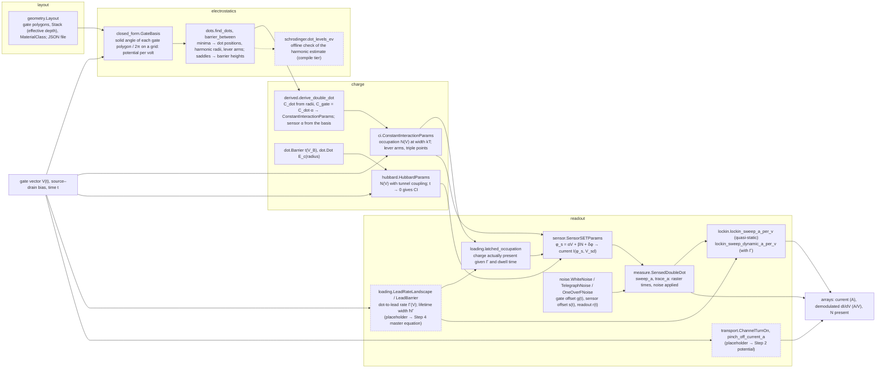
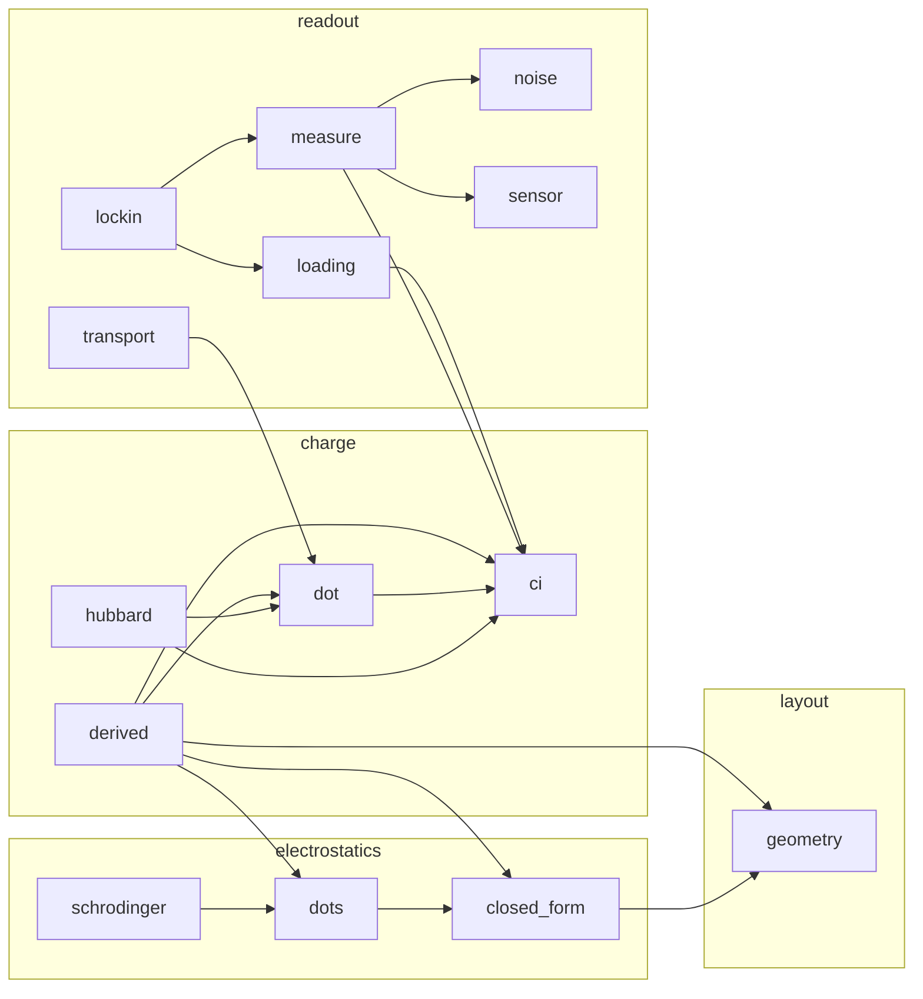

# How the models fit together (ADR 0011)

Two diagrams and a runtime ledger, kept current with every change to a model. The first diagram is
drawn by hand and says how a measurement is produced from a gate vector: which model feeds which, in the
order the physics happens. Whoever adds or rewires a model updates it in the same pull request. The
second is generated from the imports in `src/phantom` by `scripts/model_graph.py` and checked in CI, so
it can never be stale. The ledger records what each model and each protocol costs to run: declared
budgets from the protocol files, and the last measurement recorded by `scripts/gallery.py --record`.

## Measurement flow (hand-maintained)

Read left to right: a layout and a gate vector go in, a measured quantity comes out. Boxes are models;
the layer each lives in is named in the box. Dashed boxes are placeholders or offline checks that a later
step replaces (the step is named).

Which protocol uses which path (Step 1):

| protocol | path |
|---|---|
| `turn-on-single-gate`, `pinch-off-barrier` | V → transport → current |
| `coulomb-oscillations-single-dot`, `diamonds-single-dot`, `sensor-coulomb-peak` | V → CI (plungers at 0) → sensor → current; the sensor is itself the single dot in transport |
| `stability-coarse-2dot`, `stability-fine-2dot` | V(t) → CI → sensor, with noise through measure |
| `stability-lockin-p1`, `-p2`, `-common`, `-detuning` | V(t) chopped → rates → CI (broadened) → latched occupation → sensor → demodulation |
| `plunger-vs-barrier-map` | V → CI with a lead-barrier gate → LeadBarrier rate → latched occupation → sensor |
| `noise-time-trace`, `noise-psd` | fixed V, t → noise → measure → current |
| `potential-map-layout`, `potential-cut-along-channel` | Layout → GateBasis → U(x, y) at the operating point (Step 2) |
| `stability-coarse-2dot-layout` | Layout → GateBasis → dots → derived CI and sensor α → sensor flank set → sweep with noise (Step 2) |
| `pinch-off-crosstalk` | Layout → GateBasis at the barrier → linear pinch-off line; phenomenological step (Step 2) |
| `turn-on-global`, `turn-on-single-gate-layout`, `gate-hysteresis` | Layout → GateBasis → highest energy along the channel → transport.channel_transmission_current_a (Step 2) |
| `gate-leakage-iv`, `ohmic-iv` | Layout gate areas and stack thickness → transport.gate_leakage_current_a; transport.ohmic_current_a (Step 2, phenomenological) |
| `crosstalk-lines` | Layout → derived CI and sensor α → noise-free maps against four gate pairs (Step 2) |

## Module dependency graph (generated; do not edit by hand)

<!-- module-graph:start -->

| module | what it owns |
|---|---|
| `charge.ci` | Constant-interaction (CI) model of a few-electron double quantum dot. |
| `charge.derived` | Charge-model parameters derived from a layout instead of typed (Step 2, ADR 0013). |
| `charge.dot` | Dots and barriers as the named parts of a charge model. |
| `charge.hubbard` | Two-site extended Hubbard model of a few-electron double dot. |
| `electrostatics.closed_form` | Closed-form potential of polygonal surface gates over a two-dimensional electron gas. |
| `electrostatics.dots` | Dots and barriers as features of the potential-energy landscape. |
| `electrostatics.schrodinger` | Two-dimensional effective-mass Schrödinger solve on a potential-energy window: dot levels and spacings. |
| `layout.geometry` | Gate polygons, the dielectric stack and the material class: data only, no physics. |
| `readout.loading` | Rate-limited loading of the dots from their reservoirs, and the lead-rate landscape over gate space. |
| `readout.lockin` | The `sensor_lockin` channel: a hardware derivative of the sensor signal. |
| `readout.measure` | A double dot read by an SET sensor, with noise on an explicit time axis. |
| `readout.noise` | Noise processes with an explicit time axis. |
| `readout.sensor` | A charge sensor: a single-electron transistor (SET) read in sequential tunnelling. |
| `readout.transport` | Channel turn-on and barrier pinch-off: the direct-current shapes of the electrical-health protocols. |
<!-- module-graph:end -->

## Runtimes (generated from `docs/gallery/measured.json` and the protocol files; do not edit by hand)

<!-- runtimes:start -->
Last recorded on 2026-10-26 at commit `a0dac4b` on Windows-11-10.0.26200-SP0 (python 3.12.10, numpy 2.5.4), by `scripts/gallery.py --record`. Wall times are machine-dependent; counts are exact. The reference platform's numbers are in the CI artifact `gallery-ubuntu-latest` (ADR 0010).

### Per model (microseconds per point or sample)

| model | what is timed | points | us per point |
|---|---|---|---|
| `charge.ci.ConstantInteractionParams.mean_occupation` | thermal occupation per gate point | 10,000 | 1.25 |
| `charge.hubbard.HubbardParams.mean_occupation` | 16x16 diagonalisation per gate point | 10,000 | 10.059 |
| `readout.sensor.SensorSETParams.current_a` | sensor current per point | 100,000 | 0.095 |
| `readout.noise.TelegraphNoise.trace` | one fluctuator per sample | 100,000 | 0.66 |
| `readout.noise.OneOverFNoise.trace` | 24 fluctuators per sample | 10,000 | 16.039 |
| `readout.measure.SensedDoubleDot.sweep_a (noisy)` | occupation + sensor + three noise traces per point | 10,000 | 18.603 |
| `readout.lockin.lockin_sweep_a_per_v` | 8 evaluations per point, noisy | 2,500 | 146.495 |
| `readout.lockin.lockin_sweep_dynamic_a_per_v` | 8 evaluations + rate dynamics per point, noisy | 2,500 | 154.772 |
| `readout.loading.latched_occupation` | per scan step | 100,000 | 0.946 |

### Per protocol (declared budget beside the last measurement)

| protocol | points | compile budget s / measured | run budget ms per point / measured | evaluations per point |
|---|---|---|---|---|
| `coulomb-oscillations-single-dot` | 1,201 | 0.5 / 0.0 | 0.05 / 0.00191 | 1 |
| `crosstalk-lines` | 57,600 | 0.5 / 0.0898 | 0.05 / 0.00192 | 1 |
| `diamonds-single-dot` | 64,521 | 0.5 / 0.0 | 0.02 / 0.00015 | 1 |
| `gate-hysteresis` | 361 | 0.5 / 0.0479 | 1.0 / 0.08021 | 1 |
| `gate-leakage-iv` | 1,806 | 0.5 / 0.0 | 0.02 / 0.00011 | 1 |
| `noise-psd` | 30,000 | 0.5 / 0.0087 | 0.1 / 0.01903 | 1 |
| `noise-time-trace` | 30,000 | 0.5 / 0.0004 | 0.1 / 0.0185 | 1 |
| `ohmic-iv` | 201 | 0.5 / 0.0 | 0.02 / 3e-05 | 1 |
| `pinch-off-barrier` | 601 | 0.5 / 0.0 | 0.02 / 3e-05 | 1 |
| `pinch-off-crosstalk` | 24,321 | 0.5 / 0.0431 | 0.01 / 2e-05 | 1 |
| `plunger-vs-barrier-map` | 28,800 | 0.5 / 0.0001 | 0.05 / 0.00277 | 1 |
| `potential-cut-along-channel` | 1,203 | 0.5 / 0.0419 | 0.01 / 0.00036 | 1 |
| `potential-map-layout` | 34,578 | 0.5 / 0.0417 | 0.001 / 0.0 | 1 |
| `sensor-coulomb-peak` | 601 | 0.5 / 0.0 | 0.02 / 0.00157 | 1 |
| `stability-coarse-2dot-layout` | 22,500 | 0.5 / 0.0834 | 0.1 / 0.01872 | 1 |
| `stability-coarse-2dot` | 40,000 | 0.5 / 0.0003 | 0.1 / 0.0188 | 1 |
| `stability-fine-2dot` | 22,500 | 0.5 / 0.0005 | 0.1 / 0.01951 | 1 |
| `stability-lockin-common` | 40,000 | 0.5 / 0.0004 | 0.5 / 0.17205 | 8 |
| `stability-lockin-detuning` | 40,000 | 0.5 / 0.0004 | 0.5 / 0.16169 | 8 |
| `stability-lockin-p1` | 40,000 | 0.5 / 0.0004 | 0.5 / 0.15967 | 8 |
| `stability-lockin-p2` | 40,000 | 0.5 / 0.0008 | 0.5 / 0.16079 | 8 |
| `turn-on-global` | 201 | 0.5 / 0.0377 | 1.0 / 0.07718 | 1 |
| `turn-on-single-gate-layout` | 361 | 0.5 / 0.0365 | 1.0 / 0.07456 | 1 |
| `turn-on-single-gate` | 601 | 0.5 / 0.0 | 0.02 / 0.00011 | 1 |
<!-- runtimes:end -->
