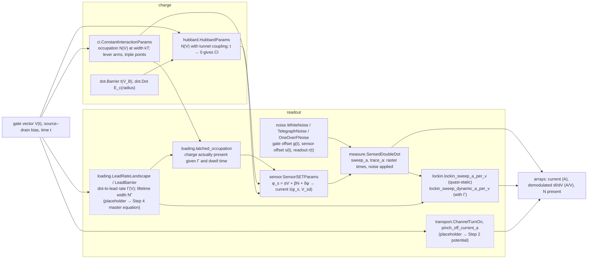
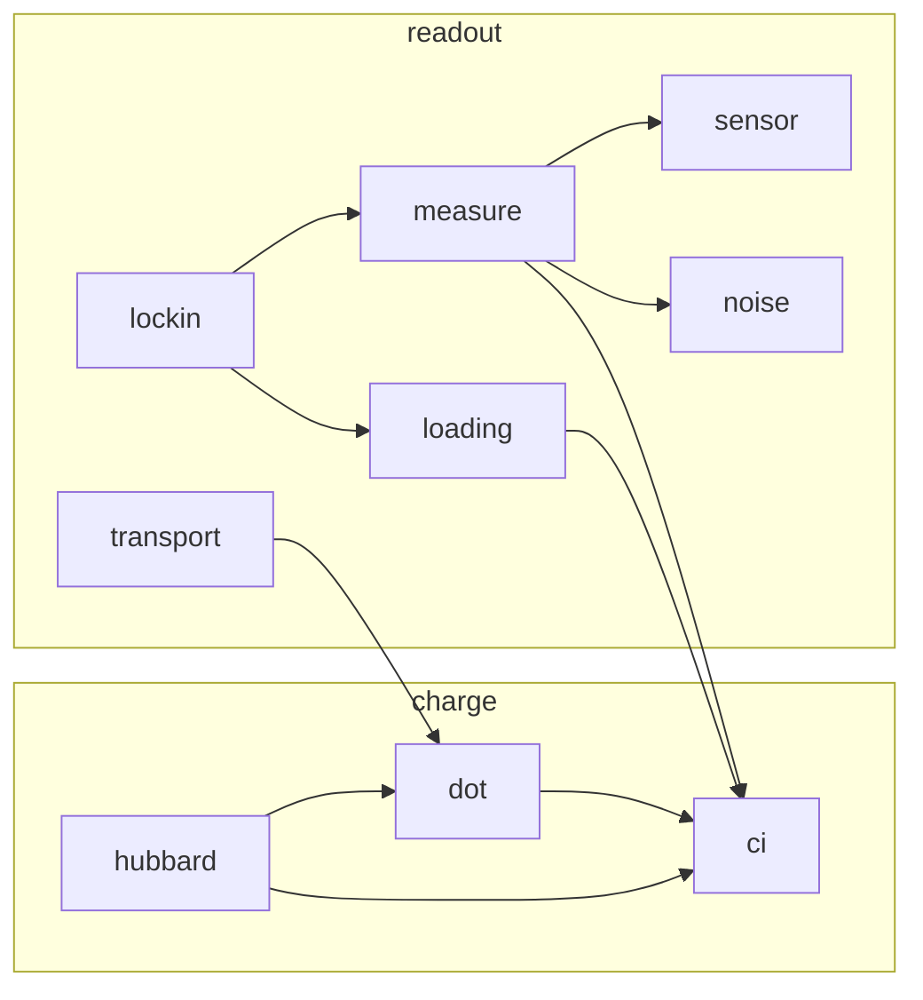

# How the models fit together (ADR 0011)

Two diagrams, kept current with every change to a model. The first is drawn by hand and says how a
measurement is produced from a gate vector: which model feeds which, in the order the physics happens.
Whoever adds or rewires a model updates it in the same pull request. The second is generated from the
imports in `src/phantom` by `scripts/model_graph.py` and checked in CI, so it can never be stale.

## Measurement flow (hand-maintained)

Read left to right: a gate vector and a time go in, a measured quantity comes out. Boxes are models;
the layer each lives in is named in the box. Dashed boxes are Step 1 placeholders that a later step
replaces (the step is named).

Which protocol uses which path (Step 1):

| protocol | path |
|---|---|
| `turn-on-single-gate`, `pinch-off-barrier` | V → transport → current |
| `coulomb-oscillations-single-dot`, `diamonds-single-dot`, `sensor-coulomb-peak` | V → CI (plungers at 0) → sensor → current; the sensor is itself the single dot in transport |
| `stability-coarse-2dot`, `stability-fine-2dot` | V(t) → CI → sensor, with noise through measure |
| `stability-lockin-p1`, `-p2`, `-common`, `-detuning` | V(t) chopped → rates → CI (broadened) → latched occupation → sensor → demodulation |
| `plunger-vs-barrier-map` | V → CI with a lead-barrier gate → LeadBarrier rate → latched occupation → sensor |
| `noise-time-trace`, `noise-psd` | fixed V, t → noise → measure → current |

## Module dependency graph (generated; do not edit by hand)

<!-- module-graph:start -->

| module | what it owns |
|---|---|
| `charge.ci` | Constant-interaction (CI) model of a few-electron double quantum dot. |
| `charge.dot` | Dots and barriers as the named parts of a charge model. |
| `charge.hubbard` | Two-site extended Hubbard model of a few-electron double dot. |
| `readout.loading` | Rate-limited loading of the dots from their reservoirs, and the lead-rate landscape over gate space. |
| `readout.lockin` | The `sensor_lockin` channel: a hardware derivative of the sensor signal. |
| `readout.measure` | A double dot read by an SET sensor, with noise on an explicit time axis. |
| `readout.noise` | Noise processes with an explicit time axis. |
| `readout.sensor` | A charge sensor: a single-electron transistor (SET) read in sequential tunnelling. |
| `readout.transport` | Channel turn-on and barrier pinch-off: the direct-current shapes of the electrical-health protocols. |
<!-- module-graph:end -->
