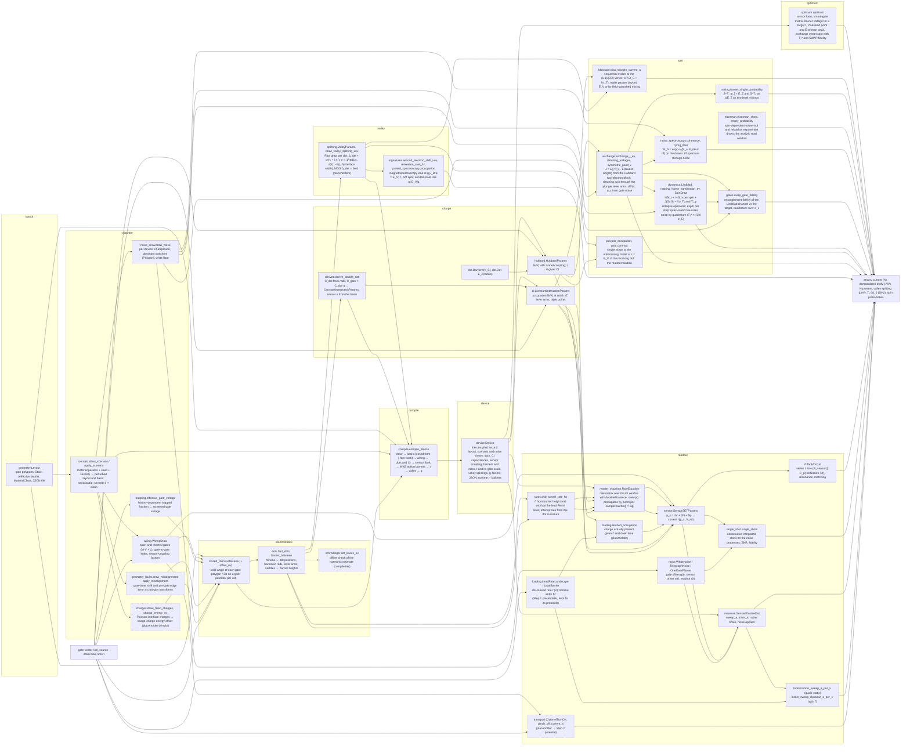
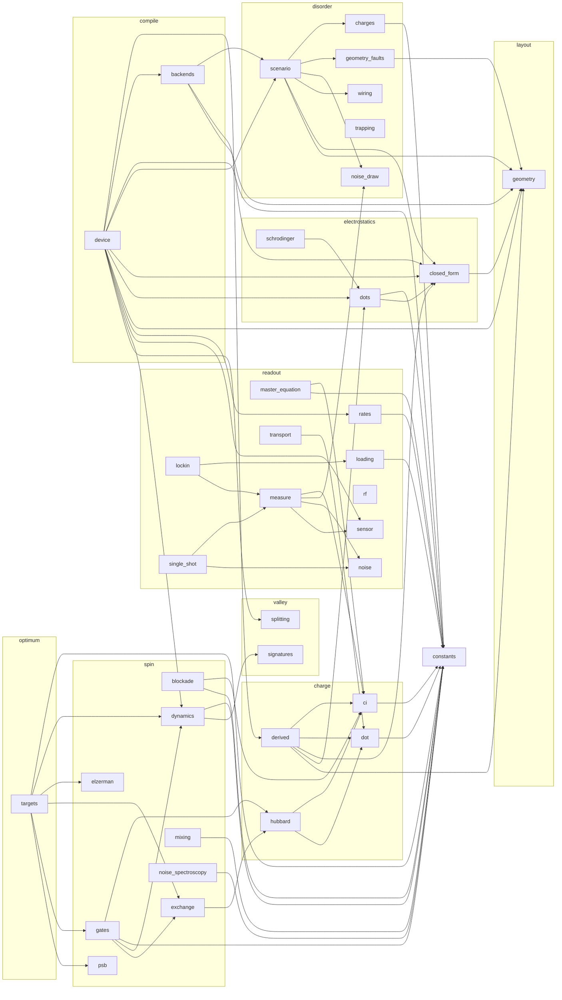

# How the models fit together (ADR 0011)

Two diagrams and a runtime ledger, kept current with every change to a model. The first diagram is
drawn by hand and says how a measurement is produced from a gate vector: which model feeds which, in the
order the physics happens. Whoever adds or rewires a model updates it in the same pull request. The
second is generated from the imports in `src/phantom` by `scripts/model_graph.py` and checked in CI, so
it can never be stale. The ledger records what each model and each protocol costs to run: declared
budgets from the protocol files, and the last measurement recorded by `scripts/gallery.py --record`.

## Measurement flow (hand-maintained)

Read left to right: a layout and a gate vector go in, a measured quantity comes out. Boxes are models;
the layer each lives in is named in the box. Dashed boxes are placeholders or offline checks that a later
step replaces (the step is named).

Which protocol uses which path (Step 1):

| protocol | path |
|---|---|
| `turn-on-single-gate`, `pinch-off-barrier` | V → transport → current |
| `coulomb-oscillations-single-dot`, `diamonds-single-dot`, `sensor-coulomb-peak` | V → CI (plungers at 0) → sensor → current; the sensor is itself the single dot in transport |
| `stability-coarse-2dot`, `stability-fine-2dot` | V(t) → CI → sensor, with noise through measure |
| `stability-lockin-p1`, `-p2`, `-common`, `-detuning` | V(t) chopped → rates → CI (broadened) → latched occupation → sensor → demodulation |
| `noise-time-trace`, `noise-psd` | fixed V, t → noise → measure → current |
| `potential-map-layout`, `potential-cut-along-channel` | Layout → GateBasis → U(x, y) at the operating point (Step 2) |
| `stability-coarse-2dot-layout` | Layout → GateBasis → dots → derived CI and sensor α → sensor flank set → sweep with noise (Step 2) |
| `pinch-off-crosstalk` | Layout → GateBasis at the barrier → linear pinch-off line; phenomenological step (Step 2) |
| `turn-on-global`, `turn-on-single-gate-layout`, `gate-hysteresis` | Layout → GateBasis → highest energy along the channel → transport.channel_transmission_current_a (Step 2) |
| `gate-leakage-iv`, `ohmic-iv` | Layout gate areas and stack thickness → transport.gate_leakage_current_a; transport.ohmic_current_a (Step 2, phenomenological) |
| `crosstalk-lines` | Layout → derived CI and sensor α → noise-free maps against four gate pairs (Step 2) |
| `potential-map-disorder` | Layout → scenario draw (charges, misalignment) → perturbed basis → U(x, y), clean beside draws (Step 3) |
| `stability-coarse-2dot-disorder` | Layout → scenario draw → perturbed basis → dots → derived CI and sensor α → sensor flank → sweep, per draw (Step 3) |
| `unintentional-dots` | Layout (MOS) → many scenario draws → minima count in the channel vs. density (Step 3) |
| `fault-signatures-stability` | Layout → wiring draw applied to programmed V → derived CI and sensor (β scaled) → sweep (Step 3) |
| `gate-leakage-pair` | wiring leak network + transport.gate_leakage_current_a (Step 3) |
| `gate-hysteresis-trapping` | trapping → effective gate voltage → channel barrier → transport.channel_transmission_current_a (Step 3) |
| `stability-vs-sweep-rate`, `stability-direction` | Layout → dots and barriers → WKB rates → RateEquation.sweep along the raster → sensor (Step 4) |
| `lead-rate-time-trace` | Layout → WKB lead rate → RateEquation relaxation after a plunger step (Step 4) |
| `rf-resonance`, `rf-sensor-flank` | sensor current → resistance → rf.TankCircuit reflection (Step 4) |
| `single-shot-histogram`, `snr-vs-integration-time` | sensor at the flank, two charge states → single_shot.single_shots on the noise processes (Step 4) |
| `switcher-histogram`, `drift-repeated-cuts` | noise_draw → SensedDoubleDot.from_noise_draw → traces and repeated cuts (Step 4) |
| `plunger-vs-barrier-map` | Layout → per barrier row: WKB lead rate → RateEquation.sweep along P1, carried across rows → sensor (Step 4 re-render) |
| `stability-vs-sweep-rate`, `stability-direction` | Layout → dots and barriers → WKB rates → RateEquation.sweep along the raster → sensor (Step 4) |
| `lead-rate-time-trace` | Layout → WKB lead rate → RateEquation relaxation after a plunger step (Step 4) |

## Module dependency graph (generated; do not edit by hand)

<!-- module-graph:start -->

| module | what it owns |
|---|---|
| `charge.ci` | Constant-interaction (CI) model of a few-electron double quantum dot. |
| `charge.derived` | Charge-model parameters derived from a layout instead of typed (Step 2, ADR 0013). |
| `charge.dot` | Dots and barriers as the named parts of a charge model. |
| `charge.hubbard` | Two-site extended Hubbard model of a few-electron double dot. |
| `compile.backends` | Electrostatics backends for `compile` (ADR 0023). |
| `compile.device` | `compile_device`: layout + material + seed → a versioned, serialisable `Device` (ADR 0001, 0023). |
| `constants` | Physical constants (CODATA 2018), below every layer so any layer may import them (ADR 0004). |
| `disorder.charges` | Random fixed charges at an interface, as a perturbation of the electron energy landscape. |
| `disorder.geometry_faults` | Gate misalignment and width error as transforms of the layout polygons. |
| `disorder.noise_draw` | Noise parameters drawn per device: the fluctuator ensemble behind 1/f, the dominant switchers, and |
| `disorder.scenario` | A scenario draw: material + catalog parameters + seed → a perturbed device, serialisable. |
| `disorder.trapping` | Charge trapping with gate history: the hysteresis loop in a gate sweep. |
| `disorder.wiring` | Gate wiring faults: open gates, shorted gates, gate-to-gate leakage, and sensor-coupling asymmetry. |
| `electrostatics.closed_form` | Closed-form potential of polygonal surface gates over a two-dimensional electron gas. |
| `electrostatics.dots` | Dots and barriers as features of the potential-energy landscape. |
| `electrostatics.schrodinger` | Two-dimensional effective-mass Schrödinger solve on a potential-energy window: dot levels and spacings. |
| `layout.geometry` | Gate polygons, the dielectric stack and the material class: data only, no physics. |
| `optimum.targets` | `optimum`: the best a compiled device can do, layer by layer (ADR 0023). |
| `readout.loading` | Rate-limited loading of the dots from their reservoirs, and the lead-rate landscape over gate space. |
| `readout.lockin` | The `sensor_lockin` channel: a hardware derivative of the sensor signal. |
| `readout.master_equation` | A master equation over the few-electron charge states of the double dot. |
| `readout.measure` | A double dot read by an SET sensor, with noise on an explicit time axis. |
| `readout.noise` | Noise processes with an explicit time axis. |
| `readout.rates` | Tunnel rates through barriers of the landscape, in the WKB approximation. |
| `readout.rf` | Radio-frequency reflectometry: a lumped tank circuit with the charge sensor as its load. |
| `readout.sensor` | A charge sensor: a single-electron transistor (SET) read in sequential tunnelling. |
| `readout.single_shot` | Single-shot charge readout: integrated sensor signals, their histograms, and signal-to-noise against |
| `readout.transport` | Channel turn-on and barrier pinch-off: the direct-current shapes of the electrical-health protocols. |
| `spin.blockade` | Transport through the double dot at finite bias with Pauli spin blockade (ADR 0022). |
| `spin.dynamics` | Few-spin dynamics: Hamiltonians in the rotating frame, a Lindblad propagator, and the analytic |
| `spin.elzerman` | Single-shot spin readout by spin-dependent tunnelling (Elzerman readout) (ADR 0022). |
| `spin.exchange` | Exchange J(ε, t_c) from the two-site Hubbard model, and the detuning axis in gate space (ADR 0021). |
| `spin.gates` | Fidelity of an exchange gate on the pair with the device's noise (ADR 0022). |
| `spin.mixing` | Singlet–triplet mixing of a separated pair: the spin funnel (ADR 0022). |
| `spin.noise_spectroscopy` | Charge-noise spectroscopy with the qubit as the spectrometer (ADR 0022). |
| `spin.psb` | Pauli spin blockade readout with the valley draw (ADR 0021). |
| `valley.signatures` | What a valley splitting does to measurements that do not need the spin layer (ADR 0020). |
| `valley.splitting` | Valley splitting per dot as a statistical draw (ADR 0020). |
<!-- module-graph:end -->

## Runtimes (generated from `docs/gallery/measured.json` and the protocol files; do not edit by hand)

<!-- runtimes:start -->
Last recorded on 2026-10-26 at commit `5a7d2ee` on Windows-11-10.0.26200-SP0 (python 3.12.10, numpy 2.5.4), by `scripts/gallery.py --record`. Wall times are machine-dependent; counts are exact. The reference platform's numbers are in the CI artifact `gallery-ubuntu-latest` (ADR 0010).

### Per model (microseconds per point or sample)

| model | what is timed | points | us per point |
|---|---|---|---|
| `charge.ci.ConstantInteractionParams.mean_occupation` | thermal occupation per gate point | 10,000 | 2.773 |
| `charge.hubbard.HubbardParams.mean_occupation` | 16x16 diagonalisation per gate point | 10,000 | 13.169 |
| `readout.sensor.SensorSETParams.current_a` | sensor current per point | 100,000 | 0.087 |
| `readout.noise.TelegraphNoise.trace` | one fluctuator per sample | 100,000 | 0.717 |
| `readout.noise.OneOverFNoise.trace` | 24 fluctuators per sample | 10,000 | 20.35 |
| `readout.measure.SensedDoubleDot.sweep_a (noisy)` | occupation + sensor + three noise traces per point | 10,000 | 23.447 |
| `readout.lockin.lockin_sweep_a_per_v` | 8 evaluations per point, noisy | 2,500 | 192.788 |
| `readout.lockin.lockin_sweep_dynamic_a_per_v` | 8 evaluations + rate dynamics per point, noisy | 2,500 | 189.404 |
| `readout.loading.latched_occupation` | per scan step | 100,000 | 0.945 |

### Per protocol (declared budget beside the last measurement)

| protocol | points | compile budget s / measured | run budget ms per point / measured | evaluations per point |
|---|---|---|---|---|
| `charge-noise-spectroscopy-cpmg` | 9 | 0.5 / 0.0007 | 50.0 / 4.33139 | 1 |
| `charge-noise-spectroscopy-j-vs-ramsey` | 41 | 0.5 / 0.0002 | 30.0 / 0.89351 | 1 |
| `compiled-device-roundtrip` | 29,282 | 2.0 / 0.1451 | 0.1 / 0.0028 | 1 |
| `coulomb-oscillations-single-dot` | 1,201 | 0.5 / 0.0 | 0.05 / 0.00428 | 1 |
| `crosstalk-lines` | 57,600 | 0.5 / 0.2645 | 0.05 / 0.00243 | 1 |
| `diamonds-single-dot` | 64,521 | 0.5 / 0.0 | 0.02 / 0.00011 | 1 |
| `drift-repeated-cuts` | 24,000 | 1.0 / 0.0006 | 0.1 / 0.0247 | 1 |
| `elzerman-trace` | 802,000 | 0.5 / 0.0 | 0.001 / 1e-05 | 1 |
| `esr-line` | 120,701 | 0.5 / 0.0001 | 0.002 / 2e-05 | 2 |
| `exchange-fingerprint` | 60,501 | 0.5 / 0.0002 | 0.02 / 0.00087 | 1 |
| `exchange-gate-fidelity` | 41 | 0.5 / 0.0003 | 100.0 / 21.45904 | 1 |
| `exchange-house-cells` | 22,801 | 0.5 / 0.0002 | 0.4 / 0.02979 | 8 |
| `exchange-vs-barrier` | 251 | 0.5 / 0.0003 | 0.2 / 0.00359 | 1 |
| `exchange-vs-detuning` | 401 | 0.5 / 0.0002 | 0.2 / 0.00954 | 5 |
| `fault-signatures-stability` | 57,600 | 2.0 / 0.1855 | 0.1 / 0.02927 | 1 |
| `gate-hysteresis-trapping` | 722 | 0.5 / 0.1789 | 1.0 / 0.21673 | 1 |
| `gate-hysteresis` | 361 | 0.5 / 0.1832 | 1.0 / 0.21251 | 1 |
| `gate-leakage-iv` | 2,408 | 0.5 / 0.0 | 0.02 / 9e-05 | 1 |
| `gate-leakage-pair` | 201 | 0.5 / 0.0 | 0.02 / 0.0003 | 1 |
| `lead-rate-time-trace` | 900 | 1.0 / 0.1974 | 2.0 / 0.79365 | 1 |
| `magnetospectroscopy-transition` | 1,803 | 0.5 / 0.0003 | 0.01 / 5e-05 | 1 |
| `noise-psd` | 30,000 | 0.5 / 0.0007 | 0.1 / 0.02548 | 1 |
| `noise-time-trace` | 30,000 | 0.5 / 0.0012 | 0.1 / 0.02525 | 1 |
| `ohmic-iv` | 201 | 0.5 / 0.0 | 0.02 / 4e-05 | 1 |
| `optimum-sensor-flank` | 1,601 | 2.0 / 0.2625 | 0.1 / 0.00245 | 1 |
| `pinch-off-barrier` | 601 | 0.5 / 0.0 | 0.02 / 3e-05 | 1 |
| `pinch-off-crosstalk` | 24,321 | 0.5 / 0.1952 | 0.01 / 2e-05 | 1 |
| `plunger-vs-barrier-map` | 12,000 | 5.0 / 0.36 | 2.0 / 1.09327 | 1 |
| `potential-cut-along-channel` | 1,203 | 0.5 / 0.148 | 0.01 / 0.00077 | 1 |
| `potential-map-disorder` | 344,424 | 1.0 / 0.6583 | 0.001 / 0.0 | 1 |
| `potential-map-layout` | 86,106 | 0.5 / 0.1438 | 0.001 / 1e-05 | 1 |
| `psb-bias-triangles` | 25,921 | 0.5 / 0.0002 | 0.05 / 0.00079 | 3 |
| `psb-readout-window` | 1,602 | 0.5 / 0.0002 | 0.01 / 0.00016 | 1 |
| `pulsed-gate-spectroscopy` | 60,501 | 0.5 / 0.0001 | 0.01 / 1e-05 | 1 |
| `rabi-chevron` | 20,301 | 0.5 / 0.0001 | 0.02 / 0.00235 | 1 |
| `ramsey-fringes` | 1,202 | 0.5 / 0.0001 | 0.01 / 5e-05 | 1 |
| `rf-resonance` | 4,004 | 0.5 / 0.0 | 0.01 / 5e-05 | 1 |
| `rf-sensor-flank` | 601 | 0.5 / 0.0 | 0.02 / 0.00284 | 1 |
| `sensor-coulomb-peak` | 601 | 0.5 / 0.0 | 0.02 / 0.00279 | 1 |
| `single-shot-histogram` | 2,000 | 0.5 / 0.0007 | 0.5 / 0.49137 | 1 |
| `snr-vs-integration-time` | 3,200 | 0.5 / 0.0012 | 5.0 / 1.61845 | 1 |
| `spin-funnel` | 120,701 | 0.5 / 0.0004 | 0.01 / 3e-05 | 1 |
| `stability-coarse-2dot-disorder` | 57,600 | 2.0 / 0.6037 | 0.1 / 0.02508 | 1 |
| `stability-coarse-2dot-layout` | 22,500 | 0.5 / 0.2773 | 0.1 / 0.02266 | 1 |
| `stability-coarse-2dot` | 40,000 | 0.5 / 0.0003 | 0.1 / 0.02747 | 1 |
| `stability-direction` | 12,800 | 1.0 / 0.1538 | 2.0 / 0.84123 | 1 |
| `stability-fine-2dot` | 22,500 | 0.5 / 0.0004 | 0.1 / 0.02595 | 1 |
| `stability-lockin-common` | 40,000 | 0.5 / 0.001 | 0.5 / 0.21688 | 8 |
| `stability-lockin-detuning` | 40,000 | 0.5 / 0.0006 | 0.5 / 0.22231 | 8 |
| `stability-lockin-p1` | 40,000 | 0.5 / 0.0004 | 0.5 / 0.21327 | 8 |
| `stability-lockin-p2` | 40,000 | 0.5 / 0.0004 | 0.5 / 0.22781 | 8 |
| `stability-vs-sweep-rate` | 19,200 | 1.0 / 0.1683 | 2.0 / 0.91727 | 1 |
| `switcher-histogram` | 600,000 | 1.0 / 0.0004 | 0.05 / 0.03163 | 1 |
| `t1-hot-spot` | 1,803 | 0.5 / 0.0001 | 0.01 / 3e-05 | 1 |
| `turn-on-global` | 201 | 0.5 / 0.1389 | 1.0 / 0.24221 | 1 |
| `turn-on-single-gate-layout` | 361 | 0.5 / 0.1189 | 1.0 / 0.22952 | 1 |
| `turn-on-single-gate` | 601 | 0.5 / 0.0 | 0.02 / 6e-05 | 1 |
| `unintentional-dots` | 125 | 1.0 / 0.0001 | 1000.0 / 569.50567 | 1 |
| `valley-splitting-draws` | 108,000 | 0.5 / 0.0 | 0.01 / 0.00066 | 1 |
| `virtual-gates-map` | 29,282 | 2.0 / 0.1508 | 0.1 / 0.00317 | 1 |
<!-- runtimes:end -->
